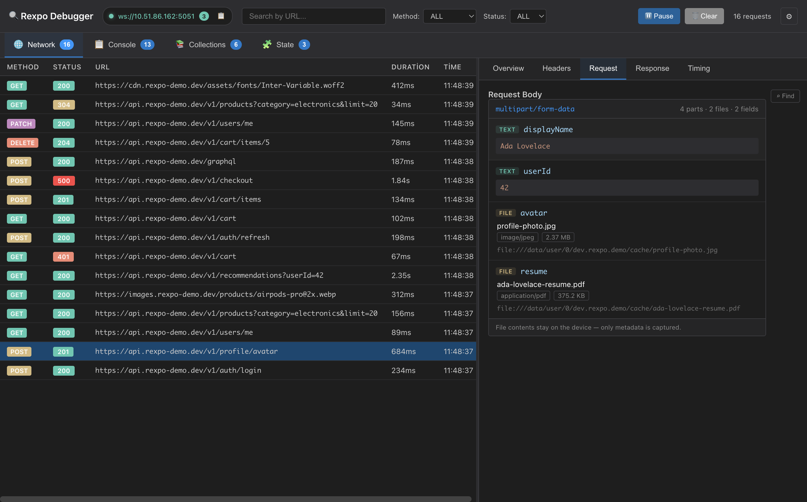

# 🔍 rexpo-debugger

<div align="center">

[](https://www.npmjs.com/package/rexpo-debugger)
[](https://www.npmjs.com/package/rexpo-debugger)
[](https://opensource.org/licenses/MIT)

**Flipper-like debugging tool for Expo and React Native apps**

**Monitor network traffic AND console logs in real-time!** 🎉

[Features](#features) • [Installation](#installation) • [Usage](#usage) • [API](#api) • [Desktop App](#desktop-app)

</div>

---

## ✨ Features

### Network Monitoring
- 🚀 **Real-time monitoring** - Capture all network requests instantly
- 📦 **Fetch & Axios support** - Automatically intercepts both
- 🔍 **Request/Response inspection** - Headers, body, timing, everything
- 📎 **File uploads** - `multipart/form-data` bodies are broken down per field, with each file's name, type, size and local uri
- 🔧 **Custom axios instances** - Support for multiple instances

### Multipart/FormData Inspector



See every multipart field and uploaded file's name, MIME type, size and
device-local URI. Bytes transfer only after an explicit Preview or Save action,
with a hard 5 MB limit.

### Console Monitoring (NEW! 🎉)
- 📋 **All console methods** - log, warn, error, info, debug
- 🎨 **Color-coded levels** - Visual distinction for each log type
- 🔍 **Stack traces** - Automatic capture for errors and warnings
- 🎯 **Rich formatting** - Objects, arrays, errors, dates, and more

### General
- ⚡ **Zero configuration** - Just initialize and go
- 💻 **Desktop inspector app** - Beautiful Electron app with tab navigation
- 🎨 **Dark theme** - Easy on the eyes
- 🔒 **Development only** - Automatically disabled in production

## 📦 Installation

```bash
# npm
npm install --save-dev rexpo-debugger

# yarn
yarn add -D rexpo-debugger

# pnpm
pnpm add -D rexpo-debugger
```

## 🚀 Quick Start

### 1. Initialize in your Expo app

```typescript
// App.tsx or index.js
import { initNetworkAgent, initConsoleAgent } from "rexpo-debugger";

if (__DEV__) {
  // Network monitoring
  initNetworkAgent({
    wsUrl: "ws://192.168.1.100:5051", // Your computer's IP
  });

  // Console monitoring (NEW!)
  initConsoleAgent({
    wsUrl: "ws://192.168.1.100:5051",
    enabled: true,
    captureStackTrace: true,
  });
}

// Your app code...
export default function App() {
  return <YourApp />;
}
```

### 2. Download Desktop Inspector

Download the desktop app from [GitHub Releases](https://github.com/omeremreelmali/rexpo-debugger/releases):

- **macOS**: `.dmg` file
- **Windows**: `.exe` installer
- **Linux**: `.AppImage` file

### 3. Start debugging! 🎉

Run your Expo app and the desktop inspector will automatically capture:
- ✅ All network requests (fetch & axios)
- ✅ All console logs (log, warn, error, info, debug)

## 📖 Usage

### Basic Setup

```typescript
import { initNetworkAgent } from "rexpo-debugger";

if (__DEV__) {
  initNetworkAgent({
    wsUrl: "ws://192.168.1.100:5051",
    enabled: true,
    maxBodyLength: 5000, // Optional: Max body snippet length
  });
}
```

### With Custom Axios Instances

```typescript
import { initNetworkAgent, addAxiosInstance } from "rexpo-debugger";
import { apiClient, authClient } from "./api";

if (__DEV__) {
  // Initialize the agent
  initNetworkAgent({
    wsUrl: "ws://192.168.1.100:5051",
  });

  // Add your custom axios instances
  addAxiosInstance(apiClient);
  addAxiosInstance(authClient);
}
```

### Platform-specific Configuration

```typescript
import { Platform } from "react-native";
import { initNetworkAgent } from "rexpo-debugger";

if (__DEV__) {
  const wsUrl = Platform.select({
    android: "ws://10.0.2.2:5051", // Android Emulator
    ios: "ws://192.168.1.100:5051", // iOS Simulator / Device
    default: "ws://192.168.1.100:5051",
  });

  initNetworkAgent({ wsUrl });
}
```

## 🔧 API

### `initNetworkAgent(options)`

Initialize the network debugging agent.

#### Options

| Option          | Type      | Required | Default | Description                            |
| --------------- | --------- | -------- | ------- | -------------------------------------- |
| `wsUrl`         | `string`  | ✅ Yes   | -       | WebSocket URL of the desktop inspector |
| `enabled`       | `boolean` | ❌ No    | `true`  | Enable/disable the agent               |
| `maxBodyLength` | `number`  | ❌ No    | `3000`  | Maximum body snippet length in bytes   |

#### Example

```typescript
initNetworkAgent({
  wsUrl: "ws://192.168.1.100:5051",
  enabled: true,
  maxBodyLength: 10000,
});
```

### `addAxiosInstance(instance)`

Add interceptors to a custom axios instance.

#### Parameters

- `instance`: Axios instance to instrument

#### Example

```typescript
import axios from "axios";
import { addAxiosInstance } from "rexpo-debugger";

const apiClient = axios.create({
  baseURL: "https://api.example.com",
});

addAxiosInstance(apiClient);
```

## 🖥️ Desktop App

The desktop inspector app provides:

- ✅ Request/Response list with filtering
- ✅ Search by URL
- ✅ Filter by method (GET, POST, etc.)
- ✅ Filter by status code
- ✅ Detailed request/response view
- ✅ JSON pretty-printing
- ✅ Timing information
- ✅ Headers inspection
- ✅ Pause/Resume capturing

## 🛠️ How to Find Your IP Address

### macOS / Linux

```bash
ifconfig | grep "inet " | grep -v 127.0.0.1
```

Or simply:

```bash
ipconfig getifaddr en0
```

### Windows

```bash
ipconfig
```

Look for the "IPv4 Address" under your active network adapter.

## 💡 Tips

### Android Emulator

Use the special IP `10.0.2.2` which points to your host machine:

```typescript
wsUrl: "ws://10.0.2.2:5051";
```

### Production Builds

The agent automatically disables itself in production (when `__DEV__` is false).

### Firewall Issues

If you can't connect, make sure port `5051` is open in your firewall.

## 🐛 Troubleshooting

### "Connection refused" error

**Solutions:**

- ✅ Make sure the desktop inspector app is running
- ✅ Check that your IP address is correct
- ✅ Ensure your device is on the same WiFi network
- ✅ Check firewall settings

### Requests not appearing

**Solutions:**

- ✅ Confirm `[NetworkAgent] Connected to inspector` in console
- ✅ Make sure you're in `__DEV__` mode
- ✅ For axios, make sure you called `addAxiosInstance()`

### Body not showing

Binary or stream-based content cannot be displayed. The agent only shows text-based request/response bodies.

`multipart/form-data` uploads are the exception: the inspector lists every field
and, for each uploaded file, its field name, file name, mime type, size and
local `file://` uri. Only metadata is sent automatically; bytes transfer after
an explicit Preview or Save action and are limited to 5 MB.

## 🤝 Contributing

Contributions are welcome! Please open an issue or submit a pull request.

## 📄 License

MIT © rexpo-debugger Contributors

## 🙏 Credits

Inspired by:

- [Flipper](https://fbflipper.com/)
- [Chrome DevTools](https://developer.chrome.com/docs/devtools/)
- [React Native Debugger](https://github.com/jhen0409/react-native-debugger)

---

<div align="center">

**Made with ❤️ for Expo developers**

[Report Bug](https://github.com/omeremreelmali/rexpo-debugger/issues) • [Request Feature](https://github.com/omeremreelmali/rexpo-debugger/issues)

</div>
